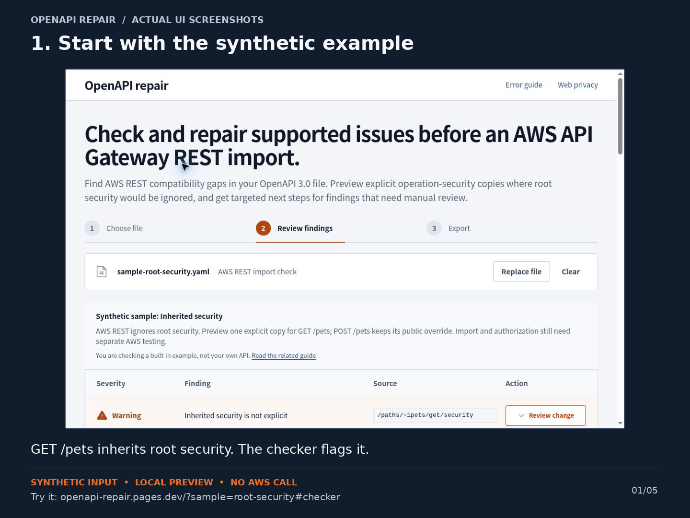

# Check an OpenAPI change before an AWS REST deployment

A small, runnable GitHub Actions example for [OpenAPI Repair](https://openapi-repair.pages.dev/). It uses the existing **offline CLI** to check selected AWS API Gateway **REST / OpenAPI 3.0** issues and distinguish a security-declaration copy from a changed access requirement.

**Try it without installing anything:** [open the inherited-security demo](https://openapi-repair.pages.dev/?sample=root-security#checker).

This is a maintainer-created example. The API files are synthetic. Nothing here calls AWS, deploys an API, creates an authorizer, or establishes secure runtime authorization.

## See the local change in 30 seconds

[](https://openapi-repair.pages.dev/?sample=root-security#checker)

[MP4](docs/root-security-walkthrough.mp4) · [Accessible transcript](docs/walkthrough.md)

This is an edited sequence of real UI screenshots, not a continuous recording or an AWS import test. GET `/pets` receives the root requirement; POST's explicit `security: []` remains unchanged. A declaration copy is not an authorization guarantee.

## Run the same checks locally

Prerequisites: Node.js 22.12 or later, Bash, curl, Python 3, and sha256sum. No npm install, account, or AWS credentials are needed.

```sh
git clone https://github.com/Masashi-Nakadaira/openapi-repair-ci-example.git
cd openapi-repair-ci-example
bash scripts/fetch-cli.sh
node scripts/replay.mjs
node scripts/preflight.mjs fixtures/explicit-copy.json fixtures/inherited.json
```

The first script downloads the existing public CLI and verifies a fixed archive **and** executable checksum. The CLI then runs locally. If the public archive changes, the recipe stops rather than running an unreviewed replacement. [Provenance and pinned actions](docs/PROVENANCE.md).

Expected results:

- An inherited GET requirement is reported by `check --fail-on warning` (exit 1)
- Copying that exact requirement onto GET is `declaration-only` in `compare` (exit 0)
- POST `[]` and PUT `[{}]` overrides stay unchanged
- Changing GET to `security: []` is detected as newly anonymous access (compare exit 1)
- The input files are unchanged after all checks

Try the deliberate negative case:

```sh
node scripts/preflight.mjs fixtures/anonymous-change.json fixtures/explicit-copy.json
# Expected exit: 1, with anonymous-access-added: 1
```

`replay.mjs` asserts the expected nonzero result; it does not silently ignore a failure. A passing replay means the synthetic examples behaved as expected, not that your API is safe.

## What happens on a pull request

[The workflow](.github/workflows/openapi-preflight.yml) checks `api/openapi.json`. On a PR it compares GitHub’s checked-out PR merge candidate with that file at the exact PR-base commit.

- `check` blocks structural/error findings. Warnings stay visible in the JSON log and job summary and require human review
- `compare` allows unchanged requirements and declaration-only changes. Added/removed operations, changed requirements, or referenced scheme definitions stop for review; incomplete coverage also stops
- The main-branch fixture intentionally starts with inherited root security. Its warnings demonstrate why green CI under an errors-only policy does not imply AWS authorization
- This is a review signal, not a deployment gate or a replacement for review. No automatic repair, merge, AWS deployment, issue comment, or report upload occurs

To use a stricter check policy yourself:

```sh
node .tools/openapi-repair.cjs check api/openapi.json --fail-on warning
```

Before adapting the workflow, review its policy and path, pin the artifact you trust, and test the complete flow on non-production definitions. Keep workflow/script changes under review. A PR can change its own checks; green CI by itself is not a security boundary.

## Privacy and CI permissions

The CLI omits file contents, filenames, API paths, operation IDs, URLs, and scheme names from the default JSON reports. This recipe never enables `--include-locations`. It does not add analytics.

**Running GitHub Actions is not the same as browser-local processing:** your repository and its checked-in definitions are processed on GitHub's runner; workflow logs are visible to people who can access the run. Use synthetic files in public repos. Do not publish customer definitions or credentials. Self-hosted runner use requires a separate security review; this example uses GitHub-hosted runners.

The workflow has only `contents: read`, does not retain checkout credentials, does not receive AWS or other repository secrets, uses no `pull_request_target`, and pins the official actions to reviewed full commit SHAs. Setup and the CLI download require network access; the CLI's analysis itself makes no network requests.

## Limits worth knowing

- OpenAPI 3.0 / API Gateway REST only; no HTTP API, Swagger 2.0, or OpenAPI 3.1 conversion
- Selected checks, not a full API compatibility or security audit
- No external `$ref` fetching or bundling
- Up to eight files, 1 MiB per file / 4 MiB total; the example checks one candidate
- Security comparison covers directly declared operations; referenced Path Items and callbacks can make coverage incomplete
- API-key requirements illustrate inheritance. API keys are not a substitute for authentication or authorization
- Actual import, integration, IAM, authorizer, and runtime behavior need separate AWS testing

Read [supported limits](https://openapi-repair.pages.dev/limitations/), [the AWS REST rule](https://docs.aws.amazon.com/apigateway/latest/developerguide/api-gateway-known-issues.html), and [the existing CLI documentation](https://openapi-repair.pages.dev/automation/).

## Did this help with a real workflow?

[Open an issue](https://github.com/Masashi-Nakadaira/openapi-repair-ci-example/issues/new) with the step you tried, whether you reached your next step, and any obstacle. A synthetic reproduction or the fixed rule ID is enough. Don't include a production/customer definition, credentials, or private logs. Please say whether you used only the demo or also tried a file of your own.

This repository does not add a license grant to the downloaded CLI or third-party components. Their existing notices remain in the downloaded archive. It is an example of the existing tool, not an AWS-endorsed product.
